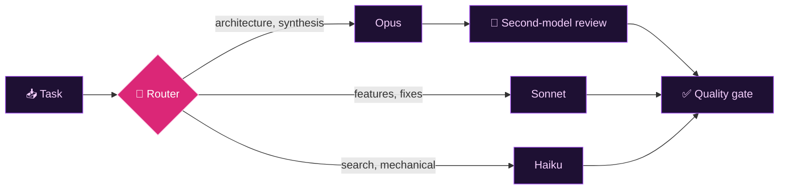

[;Full-stack+TypeScript+%C2%B7+Python;Real-time+WebSocket+systems;SvelteKit+%2F+React+%2B+PostgreSQL+in+production;Multi-agent+LLM+tooling+with+MCP;Tests+%2B+CI+on+Linux%2C+Windows+and+macOS)](https://git.io/typing-svg)

I build TypeScript and Python systems where timing and correctness matter: real-time WebSocket services, PostgreSQL-backed web apps running in production, and the multi-agent LLM tooling I use to ship them faster without skipping tests.

---

## Tech stack

**Languages**

**Frontend**

**Backend and data**

**DevOps and testing**

**AI, media and networking**

 

---

## What I can do for your team

| Area | What I do | Tools |
|---|---|---|
| 🖥️ Full-stack web apps | Role-based apps with auth, complex forms, dashboards and offline-first PWAs | SvelteKit, React, TypeScript, MUI, Tailwind, Redux Toolkit |
| 🗄️ APIs and databases | REST APIs, schema design, versioned migrations, Row Level Security, triggers, scheduled jobs | Node.js, Express, PostgreSQL, Supabase, TypeORM, Prisma, SQLite |
| 🔐 Application security | JWT auth, role-based access, CSRF origin checks, rate limiting, input validation, threat models | Zod, Helmet, Supabase Auth |
| ⚡ Real-time systems | WebSocket services with reconnect and state replay, per-client queues, latency compensation | Python asyncio, WebSockets, Node.js |
| 📊 Reporting and data viz | Dashboards, server-side chart rendering into PDF reports, Excel exports | Chart.js, Recharts, pdf-lib, ExcelJS |
| 🎬 Media and local AI | Transcription, local-LLM pipelines, video processing and automation | FFmpeg, OBS Studio, WhisperX, Ollama, OpenCV |
| 🧪 Testing and CI | Unit, integration and E2E suites; CI across Linux, Windows and macOS | Vitest, pytest, Playwright, GitHub Actions |
| 🤖 AI-assisted engineering | Model routing, evals, MCP tool integration, guardrail hooks | Claude Code, MCP |

## How I work

- **Ship to production, then keep it healthy.** Monitoring, audit logs and migrations are part of the feature, not an afterthought.
- **Tests first where it matters.** E2E tests start the real server; bugs get a failing regression test before the fix.
- **Decisions written down.** ADRs, threat models and dated security audits.
- **Adversarial review of my own fixes.** Multi-round audits, plus a second-model review on tricky concurrency.
- **Remote-friendly.** Async written communication, conventional commits, small reviewable changes.

---

## How I work with AI agents

I build daily with AI coding agents and treat them as an unreliable dependency: routed, tested and gated. A router classifies each task and sends it to the right model and specialized agent, backed by a 70+ card catalog of engineering patterns.

| Model tier | Gets | Checked by |
|---|---|---|
|  | Architecture, multi-domain synthesis, root-cause analysis, adversarial review, coordinating 5+ parallel workers | Cross-model review |
|  | Features, bug fixes, refactors, smaller fan-outs | Tests, lint, spec checks |
|  | Search, summaries, renames, formatting, inspection | Quality gate + orchestrator review |

- **Specialized agents.** Planner, code reviewer, security reviewer, TDD guide, debugger and UI/UX critic, each with its own model and tool allowlist. Delegation follows a fixed hierarchy (router → orchestrator → tool executor → MCP tools) that is never inverted, and nesting depth is capped.
- **Reusable skills.** Packaged workflows for TDD, code review, security scanning, documentation lookup and prompt optimization, loaded only when a task needs them so context stays small.
- **Cross-model verification.** For architecture decisions, a fast model flags concrete problems, a stronger model from a separate CLI reads the actual files and refines the design, the fast model re-checks its original objections, and only then does the orchestrator approve.
- **Guardrails.** Custom hooks (150+ tests) block secrets, unsafe commands and malformed commits before they land. Bash and PowerShell bootstrap scripts are equivalent on Windows and macOS. Anything that publishes requires explicit human approval.
- **Model adoption by experiment.** Before adopting a new model I measure latency, calibration and synthesis quality, then turn the findings into routing rules.

*Diagram: the router sends heavy reasoning to Opus, implementation to Sonnet and mechanical work to Haiku. Opus output gets a second-model review; everything passes the same quality gate.*

<b>Pattern catalog: 70+ cards the router and agents build on</b>

| Area | Patterns | Sources |
|---|---|---|
| Resilience | Circuit breaker, retry with backoff, timeouts and deadlines, bulkheads, idempotency, graceful degradation, rate limiting | |
| Reasoning and planning | ReAct, Reflexion, Tree of Thoughts, plan-and-execute, test-time compute | [ReAct](https://arxiv.org/abs/2210.03629) · [Reflexion](https://arxiv.org/abs/2303.11366) · [ToT](https://arxiv.org/abs/2305.10601) |
| Memory and context | Agentic memory, context engineering, hybrid GraphRAG, cognitive architectures | [GraphRAG](https://arxiv.org/abs/2404.16130) · [CoALA](https://arxiv.org/abs/2309.02427) |
| Tools and prompts | Tool-calling recovery, structured output, prompt optimization | [Toolformer](https://arxiv.org/abs/2302.04761) · [DSPy](https://arxiv.org/abs/2310.03714) |
| Security | Lethal trifecta, egress filtering, least privilege, red-teaming, multi-agent security | |
| Verification | Cross-model review, artifact verification, human-in-the-loop, determinism, agent evaluation | |
| Cost and observability | Prompt caching, token budgets, automated cost control, speculative decoding, tracing | [Speculative decoding](https://arxiv.org/abs/2211.17192) |

---

## Currently deepening

---

## GitHub activity

&nbsp;&nbsp;

Most of my work lives in private repositories, so the contribution graph includes private activity. I'm happy to walk through architecture and code in an interview.

**Open to remote roles** · Oaxaca, México (UTC-6) · Spanish (native) · <ol3rm2@gmail.com>

