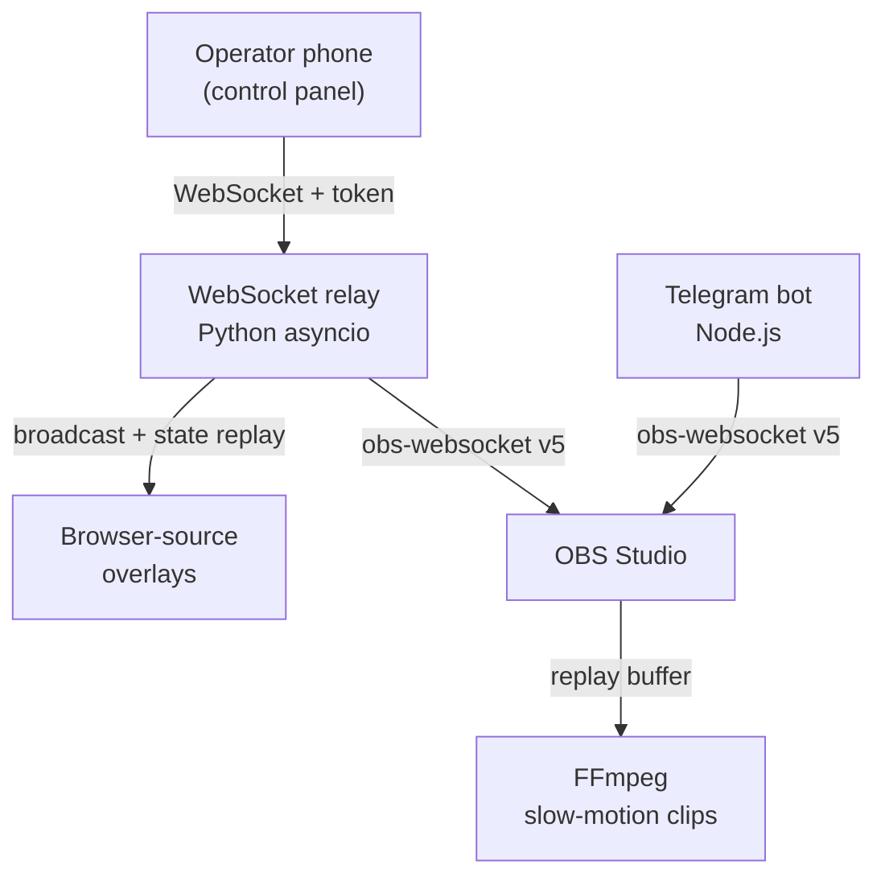
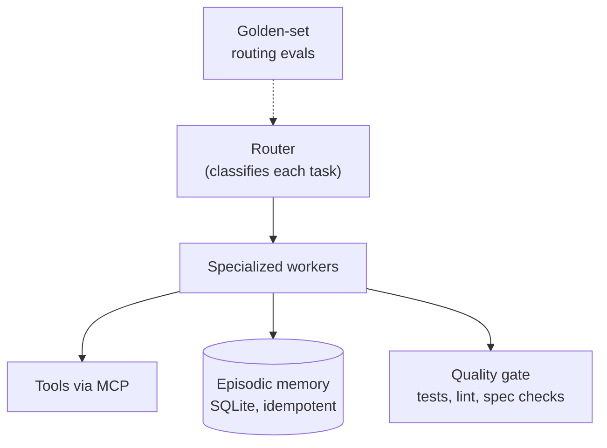

# Olegario Ramírez

**Full-stack engineer, real-time systems, LLM-agent tooling**

I build TypeScript and Python systems where timing and correctness matter: a WebSocket control plane used in live broadcasts, a PostgreSQL operations platform in production, and the multi-agent LLM tooling I use to build both.

100+ Playwright E2E cases on the relay, with CI on Linux, Windows and macOS.

Oaxaca, México (UTC−6). Open to remote roles. Email: <ol3rm2@gmail.com>

## What I build

### Live-broadcast control plane (real-time)

**Problem.** Run broadcast graphics (scoreboard, lineups, instant replay) for live sports from the on-site operator's phone, in sync with a video feed that arrives seconds late.

**Built.** A Python asyncio WebSocket relay that fans commands out to browser-source overlays and drives OBS Studio over obs-websocket v5. It keeps per-client outbox queues, replays state on reconnect, checks tokens in constant time and allowlists Origins against cross-site WebSocket hijacking. A "field mode" delays commands to match stream latency, and an FFmpeg pipeline cuts slow-motion replays. One config per event series feeds every overlay.

**Stack.** Python (asyncio, websockets), vanilla JS, OBS Studio, FFmpeg, Node.js (telegraf, Telegram bot for remote OBS control), Rust (tokio, small preflight CLI), PM2, Bash + PowerShell.

**Evidence.** Used in live broadcasts. 100+ Playwright E2E cases across 18 specs, each starting the real relay and HTTP server, run in GitHub Actions on Windows and macOS behind a Linux lint gate. The bot has an integration harness against a fake server that speaks the real obs-websocket protocol. A written threat model ships with the code.

*Diagram: the operator's phone sends authenticated WebSocket commands to a Python relay. The relay broadcasts state to browser-source overlays and controls OBS Studio over obs-websocket v5; OBS feeds replay clips to FFmpeg, and a Telegram bot also controls OBS.*

### Operations platform for an internet service provider

**Problem.** Manage customers, plans, payments and receivables, inventory, support tickets and field-technician work, including offline work.

**Built.** A SvelteKit app on Supabase/PostgreSQL. Row Level Security enforces data access in the database, with JWT auth (Supabase Auth) and role-based access on top. An audit log is written by a trigger and by the app, and pg_cron runs scheduled jobs. Hardening: database-persisted rate limiting, security headers, CSRF origin checks, Zod validation on endpoints and forms. Field technicians use an offline-first PWA (IndexedDB + service worker) with an interactive map.

**Stack.** SvelteKit (Svelte 5), TypeScript, Supabase / PostgreSQL, Zod, Chart.js, Leaflet, Tailwind, Sentry, Vercel.

**Evidence.** Deployed to production for an internet service provider. 30+ RLS policies, 10 database triggers, 14 versioned migrations.

### LLM agent orchestration framework

**Problem.** Route engineering and research tasks to the right model and tools, and keep the routing itself tested.

**Built.** A multi-agent framework I use daily. A router classifies each task and delegates it to specialized workers, with a fan-out planner for larger jobs. Tools are reached through MCP, and episodic memory lives in SQLite with idempotent writes. An automated quality gate runs unit tests, lint, spec-conformance and documentation checks.

**Stack.** Python, Node.js (zero runtime deps), SQLite, MCP.

**Evidence.** 300+ automated tests (Python + Node) and golden-set routing evals.

*Diagram: a router sends each task to specialized workers. Workers reach tools through MCP, keep idempotent SQLite memory and are checked by a quality gate; golden-set evals test the router.*

### Content-operations toolkit (alpha)

**Problem.** Run content for several social pages from one place, with per-page config and an approval step before anything is published.

**Built.** A TypeScript monorepo, still in development. A strict-TypeScript core with Zod-validated, inheritable per-page config, SQLite persistence with versioned migrations, platform adapters behind one interface and a content-queue state machine (draft, review, approved, published) designed around a human-only approval step. Also: a text-to-speech service with Python inference isolated behind a process watchdog, and an HTML-to-video wrapper.

**Stack.** TypeScript (strict, `noUncheckedIndexedAccess`), Zod, SQLite (better-sqlite3), Vitest, Python, pytest, pnpm workspaces, FFmpeg.

**Evidence.** 500+ automated tests (Vitest + pytest), including credential-handling and path-traversal tests. 5 written ADRs (API-first design, adapter shape, SQLite driver choice).

### Local-AI media pipelines

**Problem.** Turn long live streams into short captioned clips and written summaries without sending media to a paid cloud API.

**Built.** A pipeline that turns long streams into short vertical clips: word-level transcription (WhisperX), local-LLM highlight detection (Ollama), a face-aware static 9:16 crop (MediaPipe) and burned-in karaoke-style captions (FFmpeg). A second CLI transcribes downloads or live streams in chunks (faster-whisper) and drafts analysis with a local LLM. I compared several local models before picking a default.

**Stack.** Python, WhisperX, faster-whisper, Ollama, MediaPipe, OpenCV, FFmpeg, pytest.

**Evidence.** 50+ CLI tests, including a regression test that blocks reinstalling a media-download dependency version with a known CVE. Written security audit, all findings resolved.

## How I work with AI agents

- I build daily with AI coding agents (Claude Code) and treat them as an unreliable dependency: routed, tested and gated.
- Custom guardrail hooks (150+ tests) block secrets, unsafe commands and malformed commits before they land. The Bash and PowerShell bootstrap scripts are equivalent on Windows and macOS.
- Before adopting a new model I run structured experiments (latency, calibration, synthesis quality) and turn the findings into routing rules.
- My tooling is designed so that publishing requires explicit human approval.

## Engineering habits

- Decisions written down: ADRs, threat models, dated security audits.
- Adversarial review of my own fixes: multi-round audits, and a second-model review on race conditions.

## Stack

| Area | Tools |
|---|---|
| **Languages** | TypeScript (strict), Python, JavaScript / Node.js, SQL, Bash, PowerShell |
| **Web** | SvelteKit (Svelte 5), Tailwind CSS, Vite, vanilla HTML/CSS/JS. Also React / Next.js, Prisma |
| **Data & real-time** | PostgreSQL (RLS, triggers, pg_cron), Supabase, SQLite, Zod, WebSockets, REST |
| **AI / LLM** | Multi-agent orchestration, MCP, Claude Code, local LLMs (Ollama), WhisperX / faster-whisper, MediaPipe, FFmpeg |
| **Testing & delivery** | Vitest, pytest, Playwright, node:test, GitHub Actions, Biome, Ruff, Sentry, Vercel, PM2 |
| **Networking** | MikroTik RouterOS (WireGuard, firewall/NAT), Linux |

## Currently deepening

LLM application security (OWASP Top 10 for LLM Applications) and detection engineering (Sigma, MITRE ATT&CK).

---

Most of my day-to-day work shows up in this profile's contribution graph. I can walk through the architecture and code of any of these projects in an interview.

Spanish (native). Email: <ol3rm2@gmail.com>
